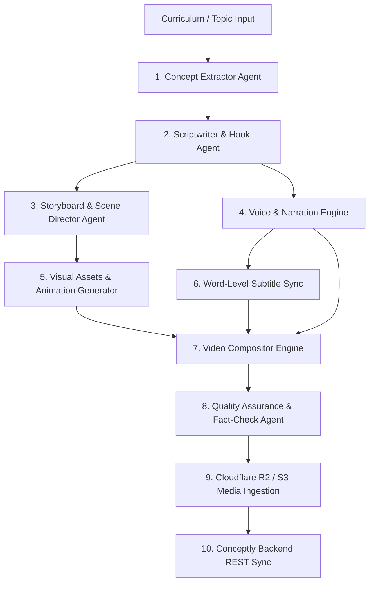

# Conceptly Studio — Autonomous Reel Generation Factory

## Overview
Conceptly Studio is an AI agent platform that autonomously generates 9:16 vertical micro-learning reels (30–60s) for NCERT (Classes 6–10), UPSC, NEET, and IIT-JEE curricula, and ingests them directly into the Conceptly live backend.

## Multi-Agent Pipeline Architecture

## Agent Responsibilities

1. **Concept Extractor Agent (`curriculum_agent.py`)**:
   - Takes chapter/topic names (e.g. "Newton's Third Law", "Photosynthesis").
   - Identifies the core misconception or counter-intuitive hook.
   - Formulates a single takeaway lesson within a 45-second attention budget.

2. **Scriptwriter & Hook Agent (`script_agent.py`)**:
   - Formats the screenplay specifically for vertical retention (0-3s hook, 3-30s explanation with analogies, 30-45s visual proof/example, 45-50s recap + call-to-quiz).
   - Generates exact spoken lines + visual direction cues `[VISUAL: ...]`.

3. **Storyboard & Scene Director Agent (`storyboard_agent.py`)**:
   - Breaks the screenplay into time-coded scenes (3–5 seconds each).
   - Decides the visual modality: code animation (Manim/Canvas), vector illustration, or dynamic text overlays.

4. **Voice & Narration Engine (`voice_agent.py`)**:
   - Converts narration into expressive speech using free high-quality neural TTS (e.g. `edge-tts`) or ElevenLabs.
   - Generates word-level timestamps (using Whisper or TTS phoneme markers) for animated bouncing subtitles.

5. **Video Compositor Engine (`render_engine.py`)**:
   - Renders 1080x1920 (9:16) vertical MP4 with crisp typography, smooth transitions, background lofi music, and kinetic subtitles.

6. **Quiz Generator Agent (`quiz_agent.py`)**:
   - Creates 2 multiple-choice checkpoint questions that test the exact insight taught in the reel.

7. **Publisher Agent (`publisher_agent.py`)**:
   - Uploads MP4 to Cloud Storage.
   - Automatically calls Conceptly API:
     - `POST /v1/curriculum/reels`
     - `POST /v1/quizzes`
