# 🧭 Conceptly Studio — System Architecture & Tool Flow

> [!NOTE]
> **Living Architectural Flow Document**  
> *Last Updated*: 2026-10-23 (Phases 1–4 Completed: 100% 3D Multi-Shot Engine, Persistent Character Store, Flexible 30–70s Duration & Broadcast Audio Mix)  
> *Detailed Ground-Truth Specification*: See [`docs/SYSTEM_BLUEPRINT.md`](file:///Users/swetanshukaushik/Developer/My%20Projects/conceptly-studio/docs/SYSTEM_BLUEPRINT.md) for the exhaustive minute-by-minute system specification.  
> *Remediation Audit & Verification Record*: See [`argon-observations.md`](file:///Users/swetanshukaushik/Developer/My%20Projects/conceptly-studio/argon-observations.md).

---

## 1. Executive System Flow

Conceptly Studio operates as an autonomous, multi-agent micro-learning video factory engineered for **vertical (9:16) 1080×1920 micro-learning cinema reels**. It enforces a strict **100% 3D SPATIAL VIDEO MANDATE** across all domains (Physics, Chemistry, Biology, Mathematics, Engineering, History/UPSC) with **ZERO 2D videos, zero flat diagrams, and zero static slideshows**.

```mermaid
flowchart TD
    A["Topic Title + Domain (NCERT / JEE / NEET / UPSC)"] --> B["Stage 0: Domain Intelligence Brain (GPT-4o / Gemini Flash)"]
    B --> C["Dynamic Persona & Character Store (AI-Selected / Gandhi / Bose / Curie / Kabir)"]
    C --> D["Stage 1: Multi-Shot 3D Screenplay & Storyboard Director (30–70s)"]
    D --> E["100% 3D Keyframe Previews (Procedural3DEngine.render_keyframe_3d)"]
    E --> F{"🛑 GATE 1: 3D Storyboard Review"}
    F -- Approved --> G["Stage 2: Fact-Check & Diagnostic MCQ Quiz Generation"]
    G --> H{"🛑 GATE 2: Assessment MCQ Review"}
    H -- Approved --> I["Stage 3: Full 3D Multi-Shot Production Pipeline"]
    I --> J["1. Neural Voice with Prosody (Edge-TTS + Rate/Pitch + RIFF WAV Transcode)"]
    J --> K["2. Dynamic Audio Chronometry Alignment (30-70s Flexible)"]
    K --> L["3. Kinetic Bouncing ASS Karaoke Subtitles (120% Pop Scale Animation)"]
    L --> M["4. Broadcast Audio Mastering (Speech + BGM Ducking -22dB + Foley SFX)"]
    M --> N["5. Multi-Shot 3D Video Clips (Host Studio, Macro Piston, Microscopic Lattice, 3D Equation HUD)"]
    N --> O["6. Final Video Motion Compositing (FFmpeg H.264/AAC 1080x1920 30fps)"]
    O --> P{"🛑 GATE 3: Mobile Reel Simulator Review"}
    P -- Approved --> Q["Stage 4: Conceptly Core Cloud Publishing"]
```

---

## 2. Tools & Engines Roster

### A. Stage 0: Domain & Pedagogical Ingestion Brain
- **Primary Agent**: `DomainIntelligenceAgent` ([`src/agents/domain_intelligence_agent.py`](file:///Users/swetanshukaushik/Developer/My%20Projects/conceptly-studio/src/agents/domain_intelligence_agent.py))
- **Underlying Engine**: Multi-LLM Cascade (`LLMFactory`):
  1. **OpenAI GPT-4o**: Structured JSON extraction of core misconception, 3-second paradox hook, 30–70s flexible scope, kinetic visual metaphor, official marking-scheme vocabulary, and diagnostic trap MCQ.
  2. **Google Gemini 2.5 / 2.0 / 1.5 Flash**: Zero-latency automatic failover when OpenAI quota is exhausted. Validates `AIzaSy` key format to avoid blocking timeouts.
  3. **Curriculum Heuristic Synthesizer**: Topic-aware offline fallback guaranteeing deterministic scientific rigor for Thermodynamics, Ohm's law, Optics, Newton's laws, Gandhi Dandi March, Bose INA, Ambedkar Constitution, and custom inputs.
- **Dynamic Character Selection Rules**:
  1. *UPSC / History / Civics*: Real historical figures (Mahatma Gandhi, Subhas Chandra Bose, Dr. B.R. Ambedkar, Napoleon Bonaparte, Dr. A.P.J. Abdul Kalam) in 3D historical environments.
  2. *STEM (Physics, Chemistry, Biology, Math)*: Real scientific pioneers (Marie Curie, Sir Isaac Newton, Albert Einstein, Srinivasa Ramanujan) OR point-to-point 3D/4D apparatus & phenomena.
  3. *Universal Fallback*: 14-year-old smart, funny, excited Indian student boy (**Kabir**, `kabir_student`).

---

### B. Teacher Persona & Persistent 3D Character Store
- **Service**: `AvatarCatalogService` ([`src/services/avatar_catalog.py`](file:///Users/swetanshukaushik/Developer/My%20Projects/conceptly-studio/src/services/avatar_catalog.py))
- **Persistent Character Store**:
  - Assets persisted permanently in `output/character_store/<avatar_slug>/avatar_3d.png` and indexed in `output/custom_avatars.json`.
  - **Cache HIT**: Reuses existing 3D character asset and neural voice profile immediately with zero overhead.
  - **Cache MISS**: Automatically synthesizes and caches a 1080×1080 3D CGI character portrait with studio volumetric lighting, authentic attire, and floating holographic props.
- **Voice Prosody Matching**:
  - `voice_rate` and `voice_pitch` configured per character persona:
    - `kabir_student`: Youthful energetic student cadence (`rate="+12%"`, `pitch="+16Hz"`).
    - Statesmen & Elders (`gandhi_cinematic`, `kalam_statesman`, `einstein_cyber`, `newton_principia`): Measured authoritative cadence (`rate="-4%"`, `pitch="-6Hz"`).

---

### C. Visual Asset Factory & 3D Keyframe Previews
- **Factory**: `VisualAssetFactory` ([`src/engines/visuals/visual_factory.py`](file:///Users/swetanshukaushik/Developer/My%20Projects/conceptly-studio/src/engines/visuals/visual_factory.py))
- **Output**: 1080×1920 (9:16) vertical imagery with safe-zone composition.
- **Gate 1 Storyboard Unification**:
  - Gate 1 preview images (`scene_01.png` ... `scene_N.png`) are rendered directly from `Procedural3DEngine.render_keyframe_3d()`.
  - Midpoint frames of the exact 3D generators ensure a 1:1 match between Gate 1 review and final Stage 3 video. Zero 2D flat drawings.

---

### D. Voice Synthesis & Broadcast Audio Mastering
- **Engines**: `EdgeTTSEngine` ([`src/engines/tts/tts_engine.py`](file:///Users/swetanshukaushik/Developer/My%20Projects/conceptly-studio/src/engines/tts/tts_engine.py)) & `AudioMixer` ([`src/engines/render/audio_mixer.py`](file:///Users/swetanshukaushik/Developer/My%20Projects/conceptly-studio/src/engines/render/audio_mixer.py))
- **Content-Addressed Audio Caching**:
  - Synthesized speech audio and word boundary metadata are indexed by `SHA256(text + voice + rate + pitch)` in `output/cache/tts_audio/`.
  - Cache hits retrieve pre-synthesized WAV + WordTimestamps in `<1ms` (up to 1049x speedup).
- **True RIFF PCM WAV Transcoding**:
  - Raw `edge-tts` MP3 stream is automatically transcoded via FFmpeg into standard 44.1kHz 16-bit stereo RIFF PCM WAV before saving to `speech_raw.wav`.
  - Unblocks `AudioMixer.mix_speech_and_bgm()`, restoring background music, `-22 dB` speech ducking, and `SoundFXEngine` foley cues (whooshes, risers, sub-bass impacts, UI clicks).

---

### E. Kinetic Subtitle Engine
- **Engine**: `SubtitleGenerator` ([`src/engines/render/subtitle_generator.py`](file:///Users/swetanshukaushik/Developer/My%20Projects/conceptly-studio/src/engines/render/subtitle_generator.py))
- **Format**: Advanced SubStation Alpha (`.ass`) with frame-accurate word highlighting.
- **Kinetic Popping Animation**:
  - Active words styled with dynamic scale bounce: `{\fscx120\fscy120\t(0,120,\fscx100\fscy100)\c&H000B9EF5&\b1}`.
  - Active word pops to 120% scale on entry and smoothly settles to 100% over 120ms with Amber (`#F59E0B`) fill, anchored at safe-zone $Y=1400$px.

---

### F. Multi-Shot 100% 3D Video Engine & Deterministic Physics
- **Engine**: `Procedural3DEngine` ([`src/engines/render/tier_3d/procedural_3d_engine.py`](file:///Users/swetanshukaushik/Developer/My%20Projects/conceptly-studio/src/engines/render/tier_3d/procedural_3d_engine.py))
- **Physics Package**: `src.engines.physics.solver` ([`src/engines/physics/solver.py`](file:///Users/swetanshukaushik/Developer/My%20Projects/conceptly-studio/src/engines/physics/solver.py))
  - Separates mathematical calculation logic from visual presentation.
  - **Thermodynamics Solver**: Exact First Law ($\Delta U = Q - W$), Ideal Gas Law ($PV = nRT$), adiabatic and isothermal expansion integrals driving 3D piston head displacement and real-time HUD telemetry.
  - **Kinematics Projectile Solver**: Newtonian ballistic trajectory $(x(t), y(t), v_x(t), v_y(t))$, apex height, range, flight time, and kinetic/potential mechanical energy conservation.
  - **Electrodynamics Solver**: Microscopic electron drift velocity ($v_d = \frac{I}{n A e}$), Ohm's Law ($V = IR$), and Coulomb charge flux.
  - **Radioactive Decay & Gravitation**: Deterministic half-life disintegration and Keplerian 2-body orbital motion.
- **Visual Polish & Styling**:
  - **Dual-Pass Optical Bloom Glow**: Applied on neon particles, laser scanlines, and equations via Gaussian blur and additive screen blending.
  - **Soft Ambient Shadows**: Smooth perspective floor drop shadows under 3D elements for spatial realism.
- **Content-Addressed Scene & Keyframe Caching**:
  - 3D MP4 scene clips cached in `output/cache/scene_clips/` and keyframes in `output/cache/keyframes/` indexed by `SHA256(scene_number + act + spoken_line + prompt + topic + avatar_id + duration)`.
  - Re-runs of identical scenes return in `<1ms`, slashing render iterations.
- **Multi-Shot Archetype Dispatcher (`_select_generator`)**:
  - Eliminates scene cloning by assigning distinct cinematic archetypes across the reel:
    1. **Opening Host Studio (`_generate_3d_character_host_frames`)**: 3D studio perspective floor grid, rotating holographic particle rings, breathing/sway parallax, speech equalizer bars, and 3D character portrait compositing.
    2. **Macro Scientific Apparatus / Mechanism**: 3D expanding thermodynamics cylinder, 3D projectile kinematics, 3D copper wire atomic lattice with drifting electrons, 3D ball-and-stick chemical reactions, twisting DNA double helix, or optics prism dispersion.
    3. **Microscopic / Core Dive**: Microscopic Brownian particle collision kinematics, cellular tomography, or organelle membranes.
    4. **3D Mathematical Formulation HUD (`_generate_hud_equation_frames`)**: Glowing mathematical card (\(\Delta U = Q - W\), \(PV = nRT\), \(V = IR\)), rotating 3D coordinate axes (\(X, Y, Z\)), variable breakdown cards, and animated laser scanline.
    5. **History / Civics Archival Hall (`_generate_historical_cinematic_3d_frames`)**: 3D perspective columns, rotating golden Ashoka Chakra / laurel seals, volumetric golden dust motes, and antique framed narrator portrait.
    6. **Outro Recap & Interactive CTA Quiz Card**: 3D host returns with a rapid concept challenge question and comment CTA banner.

---

### G. Automated Video Quality & Technical Standard Validator
- **Validator**: `VideoQualityValidator` ([`src/engines/render/validator.py`](file:///Users/swetanshukaushik/Developer/My%20Projects/conceptly-studio/src/engines/render/validator.py))
- Automatically probes each generated master reel via `ffprobe` prior to Stage 3 completion:
  - Resolution: Exactly 1080×1920 (9:16 vertical ratio).
  - Framerate: 30.0 fps ($\pm 1.5$ fps tolerance).
  - Codecs: H.264 video + stereo AAC audio.
  - Audio-to-Video Synchronization: AV drift $\le 0.50$ seconds.
  - Non-empty container and duration verification. Raises `VideoQualityValidationError` if standards are breached.

---

## 3. External API Throttling & Rate-Limit Matrix

| Provider / API | Config Variable | Free / Current Status | Throttling & Rate Limit Details | Implemented Architectural Solution |
| :--- | :--- | :--- | :--- | :--- |
| **OpenAI API** | `OPENAI_API_KEY` | ⚠️ 429 Quota Exhausted (`credit_balance_exhausted`) | Default usage tier is $0 credit balance; blocks chat and DALL-E 3 immediately. | Gracefully cascades to Gemini Flash 2.5 / 2.0 / 1.5, followed by topic-aware dynamic heuristic engine. |
| **Google Gemini** | `GEMINI_API_KEY` | ✅ Active (Free Tier) | 15 Requests Per Minute (RPM) for Gemini Flash. | Production model candidate list updated (`gemini-2.5-flash`, `gemini-2.0-flash`). Fast format validation prevents timeout hangs on invalid tokens. |
| **Microsoft Edge TTS** | None needed | ✅ 100% Free & Unlimited | Zero cost, millisecond word boundaries, supports all avatar voices. | High-performance neural speech with custom prosody (`rate`, `pitch`) + automated FFmpeg RIFF PCM WAV transcoding. |
| **Procedural 3D Engine** | None needed (Local) | ✅ 100% Free & Unlimited | Zero cloud API dependency. Generates 1080×1920 30fps H.264 video clips via streaming rawvideo FFmpeg pipe. | Complete local rendering of 3D spatial simulations, equations, historical environments, and 3D character avatars with zero API cost. |
| **Fal.ai** | `FAL_KEY` | ⏳ Optional Paid (~$0.005/img) | FLUX.1 Schnell: 4 inference steps, ~1.2s per 1080×1920 frame. | Used for Tier 4 Cinema AI diffusion when key is configured. Zero impact on Free/Procedural 3D tier. |
| **Wikimedia Commons** | N/A (Public API) | ✅ Unlimited & Free | Unlimited requests with polite `User-Agent` header (`ConceptlyStudio/1.0`). | Handled with session de-duplication and word-boundary safe regex. |
