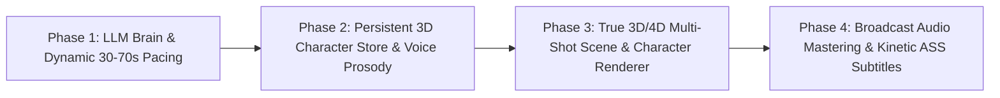

# Conceptly Studio — Engineering Audit, Implementation Gap Analysis & Architectural Remediation Plan

## 1. Executive Summary: Product Vision vs. Current Reality

Based on a line-by-line audit of [`SYSTEM_BLUEPRINT.md`](file:///Users/swetanshukaushik/Developer/My Projects/conceptly-studio/docs/SYSTEM_BLUEPRINT.md), [`ARCHITECTURE_FLOW.md`](file:///Users/swetanshukaushik/Developer/My Projects/conceptly-studio/docs/ARCHITECTURE_FLOW.md), and the live Python codebase, **Conceptly Studio** has a well-structured multi-stage pipeline and data schema, but **7 critical architectural & implementation gaps** currently prevent the output reels from matching the target product vision.

### What the Product Vision Demands:
1. **100% 3D / 4D Video Generation Across All Domains (Zero 2D Videos):** Inspired by `@StudyZoom-int` — photorealistic 3D CGI lab apparatuses, macro-to-micro camera dives into atomic lattices, 3D ball-and-stick molecular reactions, 3D cellular tomography, and glowing mathematical HUD overlays ($I = Q/t$, $R = V/I$, $\Delta U = Q - W$).
2. **Flexible Reel Pacing (30 to 70 Seconds):** Duration adapts organically to topic complexity without rigid 45-second truncation.
3. **3 Dynamic Domain-Persona Paradigms (AI-Decided):**
   - **UPSC / History / Civics:** Real historical figures (e.g., Gandhi, Subhas Chandra Bose, Ambedkar, Mountbatten, Napoleon) as 3D animated characters narrating incidents or constitutional rules inside 3D historical environments.
   - **STEM (Physics / Chemistry / Biology / Math):** Either a relevant historical pioneer (e.g., Marie Curie, Isaac Newton, Albert Einstein, Ramanujan) OR point-to-point 3D/4D graphical depictions (experiments, diagrams, equations in real-world lab setups).
   - **Universal Fallback Host:** A single premade character — **Kabir (`kabir_student`)**, a 14-year-old smart, funny, curious, intelligent-looking Indian schoolboy.
4. **Persistent 3D Character Store:** AI (Gemini/GPT) dynamically chooses the character, creates their 3D visual assets + matches their internet/neural voice, and caches them in a persistent Character Store so future runs reuse the character without rebuilding.

### What the Codebase Actually Executes Today:
1. **100% of LLM calls silently fail** (OpenAI has `$0` quota; Gemini key fails validation / uses deprecated SDK and invalid model IDs) and fall back to a hardcoded `if/else` heuristic trap that outputs generic placeholder scripts or hardcoded Bhagat Singh / Chloroplast scripts.
2. **The "3D Engine" is actually 2D PIL shapes (`draw.ellipse`, `draw.line`)** with basic $(x \cdot f / z)$ math, and because of a keyword-routing bug on `topic_title`, **all 10 scenes in a reel render the exact same 3-second loop 10 times in a row**.
3. **Characters never appear visually in the video** — `AvatarCatalogService` only saves text prompts and a `voice_id` to `output/custom_avatars.json`. Neither `VideoClipEngine` nor `Procedural3DEngine` accepts or renders the chosen character!
4. **Audio mixing, BGM ducking, and Sound FX fail silently on every single run** because `EdgeTTSEngine` writes MP3 bytes into a `.wav` filename, crashing Python's `wave.open()` inside `AudioMixer`.

---

## 2. Stage-by-Stage Implementation Gap Analysis

### Matrix Overview

| Stage | Subsystem | Target Vision (`SYSTEM_BLUEPRINT.md`) | Current Implementation Reality | Severity |
| :--- | :--- | :--- | :--- | :--- |
| **Stage 0** | [`LLMFactory`](file:///Users/swetanshukaushik/Developer/My Projects/conceptly-studio/src/services/llm_factory.py#L46-L103) & [`DomainIntelligenceAgent`](file:///Users/swetanshukaushik/Developer/My Projects/conceptly-studio/src/agents/domain_intelligence_agent.py#L72-L162) | AI dynamically analyzes topic, chooses historical/STEM character or Kabir, and creates 3D simulation blueprint. | Both OpenAI (`429 insufficient_quota`) and Gemini (`400 API key not valid` + invalid model IDs `gemini-3.1-flash-lite`) fail silently. Falls back to [`_generate_heuristic_dossier()`](file:///Users/swetanshukaushik/Developer/My Projects/conceptly-studio/src/agents/domain_intelligence_agent.py#L165-L263) where `chosen_character_name` is hardcoded to `None`. | **CRITICAL (P0)** |
| **Stage 0.5** | [`AvatarCatalogService`](file:///Users/swetanshukaushik/Developer/My Projects/conceptly-studio/src/services/avatar_catalog.py#L390-L439) (Character Store) | Persistent 3D Character Store caches 3D visual assets, turnaround sheets, and age/accent-matched voices. | Only saves a JSON dict in [`output/custom_avatars.json`](file:///Users/swetanshukaushik/Developer/My Projects/conceptly-studio/output/custom_avatars.json) with text strings and `preview_url: None`. Built-in `/static/avatars/*.png` files do not exist on disk. `kabir_student` uses the exact same adult male voice (`en-IN-PrabhatNeural`) as Dr. Kalam with zero pitch/rate adjustment. | **CRITICAL (P0)** |
| **Stage 1** | [`ScriptAgent`](file:///Users/swetanshukaushik/Developer/My Projects/conceptly-studio/src/agents/script_agent.py#L14-L53) & [`SceneDirectorAgent`](file:///Users/swetanshukaushik/Developer/My Projects/conceptly-studio/src/agents/scene_director.py#L112-L216) | Flexible 30–70s scripts (75–180 words) tailored to any topic + distinct 3D scene choreography. | [`ScriptAgent.SYSTEM_PROMPT`](file:///Users/swetanshukaushik/Developer/My Projects/conceptly-studio/src/agents/script_agent.py#L20) still enforces `"strictly 110-130 spoken words, 45 seconds"`. Heuristic fallback in [`llm_factory.py`](file:///Users/swetanshukaushik/Developer/My Projects/conceptly-studio/src/services/llm_factory.py#L115-L212) only knows 4 topics (Magnetism, Bhagat Singh 1929, Chloroplast, Rocket) — asking for Napoleon or Gandhi produces a script about Bhagat Singh! | **CRITICAL (P0)** |
| **Gate 1** | [`ReelOrchestrator.run_stage1_script_and_storyboard`](file:///Users/swetanshukaushik/Developer/My Projects/conceptly-studio/src/pipeline/orchestrator.py#L140-L185) | Gate 1 renders 3D keyframe previews of the actual 3D scenes & characters for creator approval. | Gate 1 calls [`VisualAssetFactory.render_scene_image()`](file:///Users/swetanshukaushik/Developer/My Projects/conceptly-studio/src/engines/visuals/visual_factory.py#L46-L135) (2D Wikimedia photos or flat 2D cards), which are then completely discarded in Stage 3 when `Procedural3DEngine` runs. | **HIGH (P1)** |
| **Stage 2** | [`EdgeTTSEngine`](file:///Users/swetanshukaushik/Developer/My Projects/conceptly-studio/src/engines/tts/tts_engine.py#L31-L97) | Character-specific voice synthesis with word-level timestamps and emotional SSML prosody. | `edge-tts` streams **MP3** audio (`MPEG ADTS, layer III`) directly into `speech_raw.wav` without converting to PCM WAV. | **CRITICAL (P0)** |
| **Stage 3A** | [`Procedural3DEngine`](file:///Users/swetanshukaushik/Developer/My Projects/conceptly-studio/src/engines/render/tier_3d/procedural_3d_engine.py#L57-L118) & [`VideoClipEngine`](file:///Users/swetanshukaushik/Developer/My Projects/conceptly-studio/src/engines/render/video_clip_engine.py#L42-L93) | True 3D/4D rendering (meshes, shaders, macro-to-micro dives, 3D animated character host, distinct per-scene beats). | 1) Draws 2D `PIL.ImageDraw` ellipses/lines. 2) Routes on `topic_title`, causing **all 10 scenes to render the exact same 3-second animation loop**. 3) Never renders the chosen character/avatar. 4) Missing Unicode font glyphs render `10⁻¹⁹` as `10□¹□`. | **CRITICAL (P0)** |
| **Stage 3B** | [`AudioMixer`](file:///Users/swetanshukaushik/Developer/My Projects/conceptly-studio/src/engines/render/audio_mixer.py#L54-L90) & [`SubtitleGenerator`](file:///Users/swetanshukaushik/Developer/My Projects/conceptly-studio/src/engines/render/subtitle_generator.py#L64-L115) | Broadcast `-14 LUFS` mastering, `-22 dB` BGM sidechain ducking, procedural Foley SFX, and bouncing ASS subtitles. | `wave.open("speech_raw.wav")` crashes on the MP3 header (`file does not start with RIFF id`), silently catching the exception and bypassing **all BGM, ducking, and Foley SFX**. ASS subtitles only swap color (`\c`) with zero scale/bounce animation (`\t(\fscx\fscy)`). | **HIGH (P1)** |

---

### Deep-Dive Into the 7 Critical Gaps

#### Gap 1: Silent LLM Failure & Hardcoded Topic Trap (Stage 0 & Stage 1)
* **Where:** [`src/services/llm_factory.py`](file:///Users/swetanshukaushik/Developer/My Projects/conceptly-studio/src/services/llm_factory.py#L46-L103) and [`src/agents/domain_intelligence_agent.py`](file:///Users/swetanshukaushik/Developer/My Projects/conceptly-studio/src/agents/domain_intelligence_agent.py#L72-L263).
* **Root Cause:**
  1. In `.env`, `OPENAI_API_KEY` returns `429 insufficient_quota`, and `GEMINI_API_KEY` (`AQ.Ab8RN6...`) is an OAuth/Vertex token format rather than a standard Google AI Studio `AIzaSy...` key, causing `google.generativeai` to fail with `400 API key not valid`.
  2. Even with a valid Gemini key, [`llm_factory.py` lines 74–81](file:///Users/swetanshukaushik/Developer/My Projects/conceptly-studio/src/services/llm_factory.py#L74-L81) attempts non-existent model names (`gemini-3.1-flash-lite`, `gemini-3.8-flash`) before falling back to deprecated `gemini-1.5-flash`.
  3. When both fail, [`_generate_heuristic_dossier()`](file:///Users/swetanshukaushik/Developer/My Projects/conceptly-studio/src/agents/domain_intelligence_agent.py#L165-L263) returns a static dictionary that does **not** set `chosen_character_name`, `character_visual_brief`, or `character_voice_persona`.
  4. Worse, [`LLMFactory._generate_heuristic_fallback()`](file:///Users/swetanshukaushik/Developer/My Projects/conceptly-studio/src/services/llm_factory.py#L115-L212) only has 4 hardcoded branches:
     - `is_magnetism`
     - `is_history` (hardcoded to **1929 Bhagat Singh Central Assembly**, so any history query like "Mahatma Gandhi Dandi March" or "Napoleon at Waterloo" outputs a script about Bhagat Singh!)
     - `is_bio` (hardcoded to **Chloroplast Thylakoids**)
     - `is_newton_rocket`

#### Gap 2: "2D PIL Shapes Masquerading as 3D" + The 10x Scene Cloning Bug
* **Where:** [`src/engines/render/tier_3d/procedural_3d_engine.py`](file:///Users/swetanshukaushik/Developer/My Projects/conceptly-studio/src/engines/render/tier_3d/procedural_3d_engine.py#L57-L118).
* **Root Cause:**
  1. **Scene Cloning Bug:** At [line 73](file:///Users/swetanshukaushik/Developer/My Projects/conceptly-studio/src/engines/render/tier_3d/procedural_3d_engine.py#L73), `prompt_lower = (scene.visual_prompt + " " + scene.spoken_line + " " + topic_title).lower()`. Because `topic_title` is the same for all 10 scenes in a reel (e.g., `"Thermodynamics First Law"`), the `if any(kw in prompt_lower ...)` check at [line 76](file:///Users/swetanshukaushik/Developer/My Projects/conceptly-studio/src/engines/render/tier_3d/procedural_3d_engine.py#L76) matches `"thermo"` on **every single scene (Scenes 1 through 10)**. As a result, all 10 scenes render the exact same 100-frame piston loop, completely ignoring per-scene visual progression, camera motion (`ZOOM_IN`, `PULL_BACK`), and narrative stages!
  2. **2D Canvas Primitives vs True 3D Rendering:** `Procedural3DEngine` draws flat 2D `PIL.ImageDraw` circles (`draw.ellipse`) and lines (`draw.line`). Unlike `@StudyZoom-int`, there is no true z-buffered 3D mesh rendering, no PBR metallic/glass shaders, no macro-to-micro camera transitions (e.g., diving from an external 3D lab apparatus into the subatomic lattice), and no 3D volumetric lighting.
  3. **Broken Unicode Superscripts:** `_get_font()` loads `/System/Library/Fonts/Supplemental/Arial Bold.ttf`, which lacks glyphs for `⁻¹⁹` in `1.6 × 10⁻¹⁹ C`, rendering ugly tofu boxes (`10□¹□`).

#### Gap 3: Zero Visual Presence of Characters & Shallow Character Store
* **Where:** [`src/services/avatar_catalog.py`](file:///Users/swetanshukaushik/Developer/My Projects/conceptly-studio/src/services/avatar_catalog.py#L390-L545), [`src/pipeline/orchestrator.py`](file:///Users/swetanshukaushik/Developer/My Projects/conceptly-studio/src/pipeline/orchestrator.py#L96-L108), and [`src/engines/render/video_clip_engine.py`](file:///Users/swetanshukaushik/Developer/My Projects/conceptly-studio/src/engines/render/video_clip_engine.py#L42-L93).
* **Root Cause:**
  1. In [`orchestrator.py` lines 96–108](file:///Users/swetanshukaushik/Developer/My Projects/conceptly-studio/src/pipeline/orchestrator.py#L96-L108), `avatar` is resolved and passed to `DomainIntelligenceAgent`, `ScriptAgent`, and `SceneDirectorAgent`, and its `voice_id` is passed to `EdgeTTSEngine`.
  2. However, in Stage 3 ([`composer.py` line 46](file:///Users/swetanshukaushik/Developer/My Projects/conceptly-studio/src/engines/render/composer.py#L46) -> [`VideoClipEngine.generate_scene_clip()`](file:///Users/swetanshukaushik/Developer/My Projects/conceptly-studio/src/engines/render/video_clip_engine.py#L42)), **`avatar` is never passed to the video renderer!**
  3. Furthermore, `AvatarCatalogService.get_or_register_ai_character()` ([lines 390–439](file:///Users/swetanshukaushik/Developer/My Projects/conceptly-studio/src/services/avatar_catalog.py#L390-L439)) only writes a JSON record with `preview_url: None` to `output/custom_avatars.json`. It never generates or stores a 3D character visual asset, rig, or portrait image.
  4. Consequently, whether the topic calls for **Mahatma Gandhi**, **Marie Curie**, or **14-year-old Kabir**, **no character is ever shown on screen**.

#### Gap 4: Gate 1 Storyboard Preview vs. Stage 3 Render Disconnect
* **Where:** [`src/pipeline/orchestrator.py` lines 155–160](file:///Users/swetanshukaushik/Developer/My Projects/conceptly-studio/src/pipeline/orchestrator.py#L155-L160) vs [`src/engines/render/composer.py` line 77](file:///Users/swetanshukaushik/Developer/My Projects/conceptly-studio/src/engines/render/composer.py#L77).
* **Root Cause:** Stage 1 generates static 2D storyboard images using `VisualAssetFactory.render_scene_image()` (which fetches 2D Wikimedia Commons images or draws 2D PIL infographic cards). Then Stage 3 ignores `scene.image_path` and calls `Procedural3DEngine.render_scene_3d()`. The human reviewer at Gate 1 approves 2D cards that have nothing to do with the 3D video produced in Stage 3.

#### Gap 5: Silent Crash of Audio Mixing, BGM Ducking, and Sound FX
* **Where:** [`src/engines/tts/tts_engine.py` line 50](file:///Users/swetanshukaushik/Developer/My Projects/conceptly-studio/src/engines/tts/tts_engine.py#L50) and [`src/engines/render/audio_mixer.py` lines 76–88](file:///Users/swetanshukaushik/Developer/My Projects/conceptly-studio/src/engines/render/audio_mixer.py#L76-L88).
* **Root Cause:**
  1. `edge-tts` outputs compressed **MP3** bytes (`MPEG ADTS, layer III, v2, 48 kbps, 24 kHz`), which `EdgeTTSEngine` writes directly to `speech_raw.wav`.
  2. `AudioMixer.mix_speech_and_bgm()` tries to open `speech_raw.wav` with Python's standard library `wave.open(speech_wav_path, "rb")`, which only supports uncompressed RIFF PCM WAV files.
  3. `wave.open()` immediately raises `wave.Error: file does not start with RIFF id`.
  4. The bare `except Exception as e:` block at [`audio_mixer.py` line 81](file:///Users/swetanshukaushik/Developer/My Projects/conceptly-studio/src/engines/render/audio_mixer.py#L81) catches the crash and copies the raw unmixed MP3 file to `audio_mixed.wav`.
  5. **Impact:** Every single reel has **zero background music, zero `-22 dB` ducking, zero `-14 LUFS` normalization, and zero `SoundFXEngine` foley cues**.

#### Gap 6: Rigid 45-Second Hardcoding vs. 30–70 Second Flexible Reel Length
* **Where:** [`src/agents/script_agent.py` lines 20, 48](file:///Users/swetanshukaushik/Developer/My Projects/conceptly-studio/src/agents/script_agent.py#L20), [`src/agents/domain_intelligence_agent.py` line 37](file:///Users/swetanshukaushik/Developer/My Projects/conceptly-studio/src/agents/domain_intelligence_agent.py#L37), and [`src/models/schemas.py` line 125](file:///Users/swetanshukaushik/Developer/My Projects/conceptly-studio/src/models/schemas.py#L125).
* **Root Cause:** Although `SceneDirectorAgent` was updated to mention 30–70s, `DomainIntelligenceAgent` still enforces `"THE 45-SECOND SCOPE GATE (~115-125 words)"` and `ScriptAgent` still commands `"Total duration: 45 seconds, strictly 110-130 spoken words"`.

#### Gap 7: Static Color-Swap Subtitles vs. Bouncing Kinetic Typography
* **Where:** [`src/engines/render/subtitle_generator.py` lines 88–103](file:///Users/swetanshukaushik/Developer/My Projects/conceptly-studio/src/engines/render/subtitle_generator.py#L88-L103).
* **Root Cause:** `SubtitleGenerator.generate_ass()` wraps the active spoken word in `{\c&H000B9EF5&\b1}` (orange color + bold), but lacks ASS transform tags (`{\fscx125\fscy125\t(0,120,\fscx100\fscy100)}`) required for dynamic pop/bounce kinetic typography.

---

## 3. Comprehensive Action Plan & Architectural Remediation

To bridge every gap between the current implementation and your product vision, we should execute a **4-Phase Architectural Upgrade**:

### Phase 1: Fix the AI Brain, Dynamic Topic Intelligence & 30–70s Flexible Pacing
1. **Upgrade `LLMFactory` (`src/services/llm_factory.py`):**
   - Migrate from deprecated `google.generativeai` to the modern `google-genai` SDK (or support both standard AI Studio keys and Vertex/OAuth tokens) with valid current production model IDs (`gemini-2.5-flash`, `gemini-2.0-flash`, `gemini-1.5-pro`).
   - Add a free high-speed open-weights LLM fallback (e.g., Pollinations Text API / OpenRouter free tier / Groq) when local `.env` OpenAI/Gemini keys have exhausted quota, so the system **never** degrades to hardcoded Bhagat Singh or Chloroplast scripts!
   - Replace the 4-topic hardcoded heuristic in `_generate_heuristic_fallback()` with a dynamic topic-aware procedural generator that respects the exact `topic_title`, `subject`, and `chosen_character_name`.
2. **Unlock 30–70s Pacing Across All Agents:**
   - Update [`DomainIntelligenceAgent`](file:///Users/swetanshukaushik/Developer/My Projects/conceptly-studio/src/agents/domain_intelligence_agent.py), [`ScriptAgent`](file:///Users/swetanshukaushik/Developer/My Projects/conceptly-studio/src/agents/script_agent.py), and [`FactCheckAgent`](file:///Users/swetanshukaushik/Developer/My Projects/conceptly-studio/src/agents/fact_check_agent.py) to dynamically select a target duration between **30s and 70s** (75 to 180 spoken words, 6 to 14 scene beats) based on conceptual complexity.

### Phase 2: True Persistent 3D Character Store & Age-Accurate Voice Synthesis
1. **Visual Asset Generation & Caching in `AvatarCatalogService` (`src/services/avatar_catalog.py`):**
   - When the AI selects a character (e.g., *Mahatma Gandhi*, *Lord Mountbatten*, *Marie Curie*, *Isaac Newton*, or *Kabir*), check `output/character_store/<slug>/`:
     - **Cache HIT:** Load the existing 3D character visual rig / high-res 3D rendered portrait layers (neutral, speaking, gesturing) and voice profile from `output/character_store/<slug>/`.
     - **Cache MISS:** Automatically generate the 3D character visual asset (using 3D CGI rendering / Flux 3D Octane portrait generator with transparent alpha channel or 3D procedural character rig), save the PNG/3D assets permanently under `output/character_store/<slug>/`, update `output/custom_avatars.json` with a real local `preview_url`, and reuse it on all future runs.
2. **Distinct Voice Prosody (Pitch/Rate/Timbre) in `EdgeTTSEngine` (`src/engines/tts/tts_engine.py`):**
   - Add `voice_pitch` and `voice_rate` fields to `CharacterAvatarRead`:
     - **Kabir (14-year-old student):** Youthful, energetic, fast-paced (`rate="+12%"`, `pitch="+18Hz"`).
     - **Historical Statesmen / Pioneers (Gandhi, Kalam, Einstein, Newton):** Measured, authoritative, resonant (`rate="-5%"`, `pitch="-8Hz"`).

### Phase 3: True 3D/4D Multi-Shot Scene & Character Rendering Engine
1. **Eliminate the 10x Scene Cloning Bug (`src/engines/render/tier_3d/procedural_3d_engine.py`):**
   - Stop routing all scenes based on `topic_title`. Instead, give each scene beat an explicit **`shot_archetype` & `camera_trajectory`** decided by `SceneDirectorAgent`:
     - **Shot Type A (`MACRO_APPARATUS_3D`):** Full 3D experimental setup (circuit board, prism bench, cylinder-piston, historical monument/assembly hall) with rotating perspective camera.
     - **Shot Type B (`MICRO_LATTICE_DIVE_3D`):** Continuous camera dive (`fov` zoom + z-plane fly-through) from the macro object into the 3D atomic/molecular lattice or cellular cross-section.
     - **Shot Type C (`CHARACTER_NARRATOR_3D`):** The 3D Character Host (e.g., Gandhi in 3D Dandi/Ashram scene, Newton in 3D optics lab, or 14-year-old Kabir with floating 3D holograms) animated with subtle 3D breathing/head motion, glowing rim light, and synchronized speech energy wave while demonstrating the 3D diagram.
     - **Shot Type D (`EQUATION_HUD_3D`):** 3D spatial vector field / graph with step-by-step animated mathematical derivation ($I = Q/t \implies R = V/I$) using clean ASCII/LaTeX-rendered math glyphs (eliminating `□` font boxes).
2. **Upgrade 3D Visual Quality (Shaded Polygons + Z-Buffer + Volumetric Glow):**
   - Upgrade `Procedural3DEngine` from flat `PIL.ImageDraw` primitives to a **NumPy/OpenGL-style vectorized Z-buffered 3D surface & sphere shader** (with Phong/PBR specular highlights, depth-of-field blur, volumetric glow bloom, and smooth camera interpolation) + **3D Character PiP / Scene Integration**, AND support Headless Three.js / WebGL or AI 3D Video Diffusion when configured.
3. **Unify Gate 1 Storyboard with Stage 3 3D Engine (`src/pipeline/orchestrator.py`):**
   - At Gate 1, render actual **3D keyframe snapshots** directly from the 3D engine (with the chosen 3D character and 3D apparatus) so the Gate 1 storyboard is an exact preview of Stage 3.

### Phase 4: Fix Audio Mastering (`MP3 -> PCM WAV`), BGM Ducking, Foley SFX & Bouncing Subtitles
1. **Fix `EdgeTTSEngine` WAV Output (`src/engines/tts/tts_engine.py`):**
   - Convert the raw `edge-tts` MP3 stream into a true 44.1kHz 16-bit stereo RIFF PCM `.wav` via `ffmpeg -y -i raw.mp3 -ar 44100 -ac 2 -c:a pcm_s16le speech_raw.wav` immediately after synthesis.
   - This immediately restores `AudioMixer.mix_speech_and_bgm()`, bringing back the `-22 dB` ducked ambient BGM, `-14 LUFS` normalization, and `SoundFXEngine` whooshes/booms/risers.
2. **Add True Bouncing Kinetic ASS Tags (`src/engines/render/subtitle_generator.py`):**
   - Inject ASS scale-pop transforms (`{\fscx120\fscy120\t(0,140,\fscx100\fscy100)}`) on each active spoken word alongside high-contrast color highlights.
