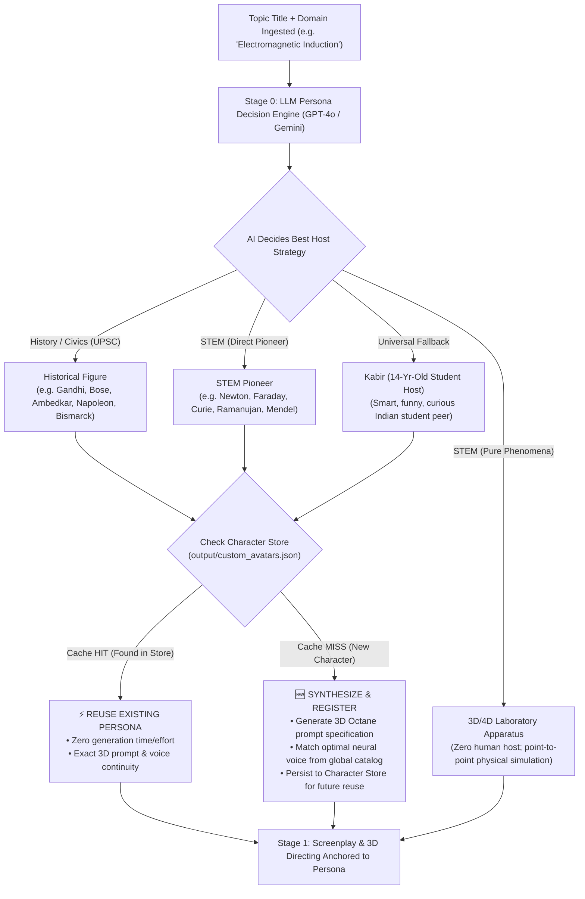
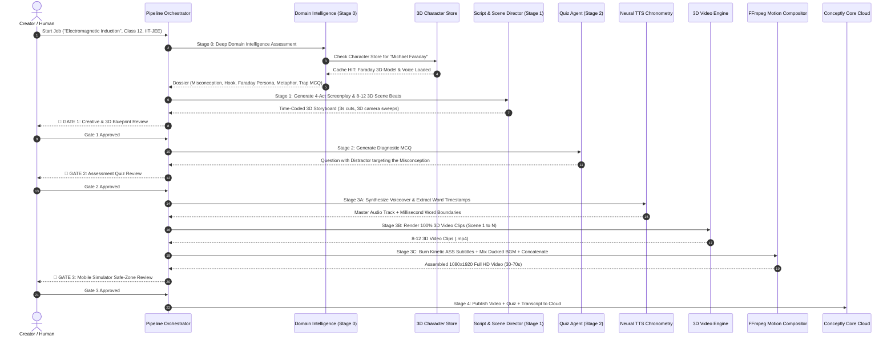

# 🧭 Conceptly Studio — Master System Blueprint & Architectural Specification

> [!IMPORTANT]
> **Definitive Ground-Truth Specification**  
> *Target Audience*: Advanced AI Models, Systems Architects, and Core Engineering Teams.  
> *Repository*: `conceptly-studio`  
> *Output Format*: Vertical 9:16 Full HD (1080×1920), 30fps H.264/AAC MP4 Cinema Reels (30 to 70 Seconds).

---

## 1. Executive Vision & Core Philosophy

**Conceptly Studio is an autonomous, multi-agent micro-learning video factory engineered to create vertical (9:16) 1080×1920 Full HD reels (30 to 70 seconds) for NCERT (Classes 6–12), IIT-JEE, NEET, and UPSC / Civil Services.**

The system is built on four core principles:
1. **100% 3D / 4D Spatial Simulation**: Zero flat 2D drawings, zero static slideshows, and zero cartoon vector cutouts. Every video is rendered as true 3D spatial geometry with dynamic time-evolution (4D).
2. **Autonomous AI Persona Decision**: Characters are not hardcoded. The AI Brain (GPT-4o / Gemini) analyzes the curriculum topic and autonomously decides who should host the reel—whether a real historical figure, a STEM pioneer, an experimental 3D/4D apparatus with no human, or our universal 14-year-old student mascot.
3. **The Persistent 3D Character Store**: When the AI chooses a persona, the system checks the **Character Store**. If that character was created in a previous run, their 3D visual assets, prompt sheets, and voice profiles are instantly reused, saving compute, time, and ensuring cross-reel visual continuity. If new, they are registered permanently into the store.
4. **The 3-Gate Human-in-the-Loop (HITL) Protocol**: Creators review the script/storyboard (Gate 1), diagnostic quiz (Gate 2), and final video in a mobile safe-zone simulator (Gate 3) before one-click publishing.

---

## 2. Autonomous AI Persona Decision & The Persistent 3D Character Store



### A. The 3 Character Archetypes Decided by the AI

1. **Historical Figures (UPSC & Civics/History)**:
   * **Mechanism**: The AI selects the real historical figure at the center of the incident or constitutional debate (e.g., *Mahatma Gandhi for Satyagraha, Netaji Subhas Chandra Bose for the INA struggle, Dr. B.R. Ambedkar for the Constitution, Napoleon Bonaparte for European warfare, Lord Mountbatten for the 1947 Partition*).
   * **Role**: The 3D historical character narrating the event, addressing the audience directly, walking through a photorealistic 3D historical environment (Assembly Hall, battlefield, ashram).
2. **STEM Pioneers & 3D/4D Phenomena (Physics, Chemistry, Biology, Math)**:
   * **Pioneer Host**: When a concept is tied to a historical scientist or mathematician (e.g., *Michael Faraday for Induction, Sir Isaac Newton for Mechanics, Marie Curie for Radioactivity, Srinivasa Ramanujan for Infinite Series, Gregor Mendel for Genetics*), the AI selects them as the 3D host.
   * **Pure Phenomena (No Human Host)**: When no single pioneer applies (or for pure mechanism topics like *Chemical Equilibrium, Thermodynamics Piston Expansion, Optics Prism Dispersion*), the AI routes to pure **3D/4D spatial simulations**: real-world laboratory apparatuses (multimeters, test tubes, optical benches) with floating equations and collision mechanics.
3. **Universal Fallback Host — Kabir (The 14-Year-Old Indian Student)**:
   * **Role**: When no major historical figure applies, the AI selects `kabir_student`.
   * **Personality**: A 14-year-old smart, witty, curious, and funny Indian schoolboy in a varsity jacket and glasses. He reacts with genuine, humorous astonishment to 3D phenomena, conducts virtual experiments, and explains concepts peer-to-peer.

### B. Dynamic Voice Matching Matrix
The system automatically maps the character's nationality, era, and gender to available neural voices:

| Persona Type / Nationality | Selected Neural Voice ID | Tone & Characteristic |
| :--- | :--- | :--- |
| **Indian Historical / Statesman** | `en-IN-PrabhatNeural` | Deep, dignified, authoritative Indian English. |
| **Indian Female Leader / Scientist** | `en-IN-NeerjaNeural` | Articulate, warm, clear Indian English. |
| **British STEM / Historical** | `en-GB-RyanNeural` | Formal, academic, classical British English (Newton, Faraday). |
| **British Female Scientist** | `en-GB-SoniaNeural` | Sharp, academic British English. |
| **Global / American / European** | `en-US-ChristopherNeural` | Authoritative, cinematic elder male voice (Einstein, Napoleon). |
| **Global Female Pioneer** | `en-US-JennyNeural` | Focused, clear, professional female voice (Curie, Franklin). |
| **Kabir (14-Year-Old Student)** | `en-IN-PrabhatNeural` (youth pitch) | Energetic, funny, excited schoolboy cadence. |

### C. Persistent Character Store Mechanics (`CharacterStore`)
* **Location**: Persisted in `output/custom_avatars.json`.
* **Lookup**: Uses normalized fuzzy slug matching (`re.sub(r"[^a-z0-9]", "", name)`).
* **Cache Hit**: If Gemini/GPT picks "Michael Faraday" and Faraday was generated previously:
  * The system pulls his established 3D visual prompt, turnaround specifications, and `en-GB-RyanNeural` voice configuration.
  * **Result**: Zero regeneration cost, 0s latency, and 100% visual/vocal consistency across reels.
* **Cache Miss**: If Gemini/GPT picks a new figure (e.g., "Johannes Kepler"):
  * The system synthesizes his 3D Octane render prompt, matches his voice, registers him with a unique ID (`store_johannes_kepler_...`), and saves him to disk. Every future reel featuring Kepler will reuse this asset automatically.

---

## 3. Project Directory Structure

```
conceptly-studio/
├── src/
│   ├── main.py                          # FastAPI Entrypoint & Web Route Registration
│   ├── cli.py                           # Headless Terminal Batch Video Generator
│   ├── core/
│   │   ├── config.py                    # Environment Configuration (API Keys, Audio LUFS, Storage Paths)
│   │   ├── database.py                  # Database Engine & Session Management
│   │   └── security.py                  # JWT Authentication & Role-Based Access Control
│   ├── models/
│   │   └── schemas.py                   # Pydantic Schemas (ReelScript, Storyboard, DomainPedagogyDossier)
│   ├── agents/
│   │   ├── domain_intelligence_agent.py # Stage 0: AI Brain (Misconceptions, Paradox Hook, Character Decision)
│   │   ├── script_agent.py              # Stage 1A: 4-Act Screenplay Synthesizer (Pacing & Word Meter)
│   │   ├── scene_director.py            # Stage 1B: 3D Scene Director (3-Second Cut Rule & 3D Prompts)
│   │   ├── quiz_agent.py                # Stage 2: Diagnostic Checkpoint Assessment (Trap MCQs)
│   │   ├── factcheck_agent.py           # Stage 1C: Scientific Truth & Marking Scheme Validator
│   │   └── publisher_agent.py           # Stage 4: Conceptly Core Cloud Publishing Dispatcher
│   ├── services/
│   │   ├── avatar_catalog.py            # Character Store & Dynamic Voice Resolution Service
│   │   └── llm_factory.py               # Multi-LLM Cascade: GPT-4o -> Gemini 2.5 Flash -> Heuristics
│   ├── engines/                         # High-Performance Synthesis Engines
│   │   ├── tts/
│   │   │   └── tts_engine.py            # Azure Edge Neural TTS with 100ns Word-Boundary Tracking
│   │   ├── render/
│   │   │   ├── tier_3d/
│   │   │   │   └── procedural_3d_engine.py # Local 3D Spatial Simulator (1080x1920 30fps MP4)
│   │   │   ├── tier4_cinema/
│   │   │   │   └── cinema_engine.py     # Fal.ai Kling 1.5 / Hailuo / Runway 3D Video Diffusion
│   │   │   ├── video_clip_engine.py     # Master 3D Video Dispatcher (Guarantees zero 2D fallback)
│   │   │   ├── motion_compositor.py     # Multi-Clip FFmpeg Video Assembler
│   │   │   └── subtitle_generator.py    # Kinetic Karaoke ASS Subtitles with Safe-Zone Clearance
│   │   ├── visuals/
│   │   │   └── visual_factory.py        # 3D CGI Diffusion & Texture Asset Factory
│   │   └── audio/
│   │       └── audio_mixer.py           # Multi-Track Audio Mixer (-14 LUFS Voice / -22 dB BGM + SFX)
│   ├── pipeline/
│   │   └── orchestrator.py              # 11-Stage Production Orchestrator
│   └── web/
│       └── index.html                   # Glassmorphic Studio Web UI & 9:16 Mobile Safe-Zone Simulator
├── output/
│   ├── custom_avatars.json              # Persistent 3D Character Store
│   └── jobs/                            # Job Workspaces (Scripts, Audio, 3D Clips, MP4 Output)
└── docs/
    ├── ARCHITECTURE_FLOW.md             # Living Architectural Flow & Rate-Limit Documentation
    └── SYSTEM_BLUEPRINT.md              # Complete Master Specification Document
```

---

## 4. The 11-Stage Pipeline: Minute Step-by-Step Anatomy



### Detailed Breakdown of Every Step:

#### Step 1: Knowledge Ingestion & Persona Decision (Stage 0)
* **File**: `src/agents/domain_intelligence_agent.py`
* **Operation**:
  1. The LLM evaluates the cognitive bottleneck, the 3-second paradox hook, and official marking-scheme keywords.
  2. The LLM selects the **3D Character Host**:
     - History $\to$ Real historical figure.
     - STEM $\to$ Related pioneer, or 3D/4D apparatus, or Kabir.
  3. Queries `src/services/avatar_catalog.py`:
     - If the character is in the Character Store $\to$ **Cache HIT**, reuses established 3D asset prompt and voice ID.
     - If new $\to$ **Cache MISS**, generates 3D prompt specification, matches optimal neural voice, and caches into `output/custom_avatars.json`.

#### Step 2: 4-Act Screenplay Generation (Stage 1A)
* **File**: `src/agents/script_agent.py`
* **Operation**: Crafts dialogue tuned to vertical retention:
  * **Act 1: The Hook (0–5s)**: Counter-intuitive paradox question.
  * **Act 2: The Core Misconception (5–20s)**: Exposes why conventional thinking fails.
  * **Act 3: The 3D Mechanism (20–45s)**: The true physical law explained at the atomic/spatial level.
  * **Act 4: The Golden Rule (45–60s)**: Formula summary, units, and quiz bridge.
* **Word Metering**: Strict calibration to **130–150 words per minute** (approx. 110–130 words for a 45s reel).

#### Step 3: 3D Scene Directing & Storyboard Beat Generation (Stage 1B)
* **File**: `src/agents/scene_director.py`
* **Operation**: Splits the dialogue into **8 to 12 time-coded visual cuts**:
  * **3-Second Cut Rule**: Every scene lasts 2.5s to 4.5s.
  * **3D Visual Prompts**: Infused with 3D CGI directives (`Cinema 4D Octane render 8K`, `volumetric rim lighting`, `3D perspective depth`).
  * **Camera Choreography**: Assigns 3D camera motions (`ZOOM_IN` macro dive, `PAN_RIGHT` orbital sweep, `PULL_BACK` crane reveal).
  * **StudyZoom HUD**: Formulates floating mathematical expressions ($I=Q/t$, $\Delta U=Q-W$, $R=V/I$) and vector arrows.

#### Step 4: Neural Voiceover & Dynamic Audio Chronometry (Stage 3A)
* **File**: `src/engines/tts/tts_engine.py`
* **Operation**:
  1. Synthesizes voiceover from the cleaned scene dialogue using Azure Neural TTS.
  2. Captures native 100-nanosecond word-boundary event timestamps.
  3. Re-aligns `scene[i].start_sec` and `scene[i].end_sec` to match the exact millisecond timestamps of the spoken voiceover.
  4. Guarantees **zero audio-video cutoffs** and frame-accurate scene transitions for reels ranging from 30 to 70 seconds.

#### Step 5: 100% 3D / 4D Video Clip Generation (Stage 3B)
* **File**: `src/engines/render/video_clip_engine.py`
* **Operation**:
  * **Local Procedural 3D Simulator (`procedural_3d_engine.py`)**:
    * Computes 3D matrices, perspective projections ($X_{screen} = \frac{x}{z} \cdot \text{fov}$, $Y_{screen} = \frac{y}{z} \cdot \text{fov}$), particle physics, and specular shading directly in memory.
    * Pipes raw RGB frames directly to FFmpeg (`-f rawvideo -pix_fmt rgb24`) to render 1080×1920 30fps MP4 clips in ~1.5s per scene with zero API costs.
  * **Cinema AI 3D Diffusion (`cinema_engine.py`)**:
    * When paid API keys (`FAL_KEY`, `RUNWAY_API_KEY`) are present, routes prompts to Kling 1.5 or Runway Gen-3 to render photorealistic 3D CGI clips.

#### Step 6: Kinetic Karaoke Subtitles (Stage 3C)
* **File**: `src/engines/render/subtitle_generator.py`
* **Operation**:
  * Emits Advanced SubStation Alpha (`.ass`) karaoke subtitles with active-word highlight timing (`\k`).
  * Word bounces dynamically with glowing Amber (`#F59E0B`) fill on active speech, white upcoming text, anchored at $Y=1400$px safe zone (above mobile UI bars).

#### Step 7: Broadcast Audio Mixing & Foley Sound Effects
* **File**: `src/engines/audio/audio_mixer.py`
* **Operation**:
  * Normalizes spoken voiceover to **`-14 LUFS`**.
  * Auto-ducks ambient synth background music to **`-22 dB`** during speech.
  * Adds foley sound effects (sub-bass whoosh on camera dives, electric hum on circuit activation, metallic click on particle collisions).

#### Step 8: FFmpeg Multi-Clip Motion Compositing
* **File**: `src/engines/render/motion_compositor.py`
* **Operation**:
  * Assembles all generated 3D video clips via FFmpeg concat protocol.
  * Binds the multi-track audio and burns kinetic subtitles via `libass`.
  * Encodes a unified 1080×1920 Full HD H.264/AAC MP4 ready for mobile playback.

#### Step 9: Diagnostic Assessment & Trap MCQ (Stage 2)
* **File**: `src/agents/quiz_agent.py`
* **Operation**: Generates an exam-style multiple-choice question where the distractor option targets the specific misconception exposed in the reel, accompanied by marking-scheme explanations.

#### Step 10: Human Review & Cloud Publishing (Stage 4)
* **File**: `src/web/index.html` & `src/agents/publisher_agent.py`
* **Operation**:
  * Creator validates the finished video inside the interactive iPhone mockup.
  * Toggles the **Safe Zone Overlay Switch** to verify clearances.
  * With one click, publishes the video, transcript, and diagnostic quiz payload to Conceptly Core.

---

## 5. Master Specifications Reference Table

| Dimension | Specification | Implementation Engine |
| :--- | :--- | :--- |
| **Aspect Ratio & Resolution** | `9:16` Vertical Full HD (1080 × 1920 px) | Native vertical framing across all render engines. |
| **Duration Range** | **30 to 70 Seconds** | Dynamic duration driven by spoken word chronometry timestamps. |
| **Visual Modality** | **100% 3D / 4D Spatial Simulation & CGI** | `Procedural3DEngine` (local) + `CinemaDiffusionEngine` (AI). |
| **Persona Selection** | **Autonomous AI Decision (GPT/Gemini)** | `DomainIntelligenceAgent` Stage 0 decision engine. |
| **Persona Persistence** | **Persistent 3D Character Store** | Cached in `output/custom_avatars.json`; instant reuse on cache hit. |
| **Voice Matching** | **Dynamic Multi-National Voice Mapping** | Azure Edge Neural TTS with gender & nationality matching. |
| **Universal Fallback Host** | **Kabir (14-Yr-Old Student Mascot)** | High-end 3D animated curious Indian schoolboy with funny reactions. |
| **Scientific HUD Graphics** | **StudyZoom Mathematical HUD Overlay** | Floating LaTeX equations, live telemetry tickers, vector arrows. |
| **Subtitles** | **Kinetic Karaoke Subtitles (.ass)** | Millisecond word alignment, bouncing Amber (`#F59E0B`) highlight. |
| **Audio Standards** | **Broadcast Multi-Track Mixing** | Voice at `-14 LUFS`, BGM ducked at `-22 dB`, synchronized foley SFX. |
| **Quality Control** | **3-Gate Human-in-the-Loop Protocol** | Creator approvals at Script (Gate 1), Quiz (Gate 2), and Simulator (Gate 3). |
